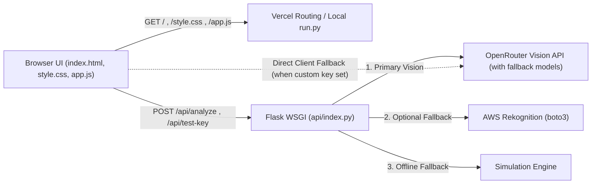

# Lumina Studio — AI Image Caption Generator

**Live App:** [https://ai-image-caption-generator-api.vercel.app/](https://ai-image-caption-generator-api.vercel.app/)

**Lumina Studio** (`v2.5.0`) is a full-stack, serverless-ready multimodal computer vision web application that analyzes images and generates editorial captions, scene narratives, entity confidence rankings, optical text (OCR), and semantic tags.

It is architected as a **single-folder deployment** ready for **Vercel** and local execution, powered primarily by **OpenRouter Multimodal Vision AI** with automatic model fallback, an optional **AWS Rekognition** fallback, and a built-in simulation mode for offline previews.

---

## Table of Contents

1. [Architecture Overview](#architecture-overview)
2. [Key Features](#key-features)
3. [Project Structure](#project-structure)
4. [Tech Stack](#tech-stack)
5. [Local Development Setup](#local-development-setup)
6. [Deploying to Vercel](#deploying-to-vercel)
7. [API Reference](#api-reference)
8. [Environment Variables & Security](#environment-variables--security)
9. [Troubleshooting](#troubleshooting)

---

## Architecture Overview

The application keeps both frontend static assets and the Python serverless backend in a single repository root so it can run seamlessly on Vercel or locally via Flask:



### Inference Resolution Order

When analyzing an image (`POST /api/analyze`), the backend resolves engines in the following order (unless pinned via the UI segmented selector):

1. **OpenRouter Multimodal Vision (`openrouter`)**:
   - Primary model: `particle-ai/particle-1:free` (configurable via `OPENROUTER_MODEL`).
   - Automatic fallback chain if a free upstream provider is busy or rate-limited:
     1. `particle-ai/particle-1:free`
     2. `google/gemma-4-26b-a4b-it:free`
     3. `google/gemma-4-31b-it:free`
     4. `inclusionai/ling-3.2-flash:free`
   - Normalizes model JSON outputs into a consistent UI schema (`labels_summary`, `hashtags`, `detected_text`).
2. **AWS Rekognition (`aws`)** *(Optional)*:
   - Uses `DetectLabels` (`GENERAL_LABELS`, `IMAGE_PROPERTIES`) and `DetectText` when AWS credentials are configured, then synthesizes structured captions and tags.
   - *Note:* `boto3` is intentionally excluded from `api/requirements.txt` to stay well within Vercel's serverless function size limit; it is imported lazily if installed in your runtime.
3. **Simulation Fallback (`demo`)**:
   - Returns structured sample insights when no API key is configured so the UI remains inspectable.
4. **Browser Direct Fallback**:
   - In `app.js`, if `/api/analyze` is unreachable and the user saved an OpenRouter key in **Settings**, the browser calls OpenRouter's `/api/v1/chat/completions` endpoint directly.

---

## Key Features

- **Editorial & Structured Vision Output**:
  - **Primary Caption**: Polished single-sentence summary with character and word counters.
  - **Headline Chip**: 3–5 word concise title (`short_caption`).
  - **Scene Narrative**: Multi-sentence breakdown covering composition, color palette, and lighting.
  - **Detected Entities & Confidence**: Visual confidence meters for detected subjects and objects.
  - **Optical Character Recognition (OCR)**: Displays detected text snippets when present in the image.
  - **Semantic Keywords & Tags**: Clickable hashtag pills with one-click copy.
  - **Raw Response Payload**: Collapsible JSON inspector showing exact API output, active model, and latency.
- **API Connectivity Verification (`Ping API` / `Test Key`)**:
  - Validates OpenRouter API keys directly against `https://openrouter.ai/api/v1/auth/key` and reports round-trip latency in milliseconds without triggering shared model rate limits.
- **Flexible Image Input**:
  - Drag-and-drop file upload, storage file picker, and system clipboard paste (`Ctrl+V` / `Cmd+V`).
  - Keyboard shortcut (`Ctrl+Enter` / `Cmd+Enter`) to execute analysis.
  - Built-in reference presets (*Alpine Landscape*, *Modern Architecture*, *Wildlife Portrait*, *Athletic Action*) rendered to PNG via HTML5 `<canvas>` for instant testing.
- **Built-in Accessibility & Utilities**:
  - **Text-to-Speech (`Speak`)**: Reads the generated primary caption aloud via the Web Speech API (`window.speechSynthesis`).
  - **Settings Modal**: Configure OpenRouter API key, optional separate backend host URL, and optional AWS credentials in browser `localStorage` and session config.

---

## Project Structure

```text
ai-image-caption-generator/
├── api/
│   ├── index.py            # Self-contained Flask WSGI app (API + static fallback)
│   └── requirements.txt    # Minimal Vercel serverless dependencies (flask, flask-cors, python-dotenv)
├── index.html              # Lumina Studio web application UI
├── style.css               # Dark-theme SaaS design system (Inter, Plus Jakarta Sans, JetBrains Mono)
├── app.js                  # Client controller, canvas samples, TTS, & direct OpenRouter fallback
├── run.py                  # Local development server launcher (serves root static files + API)
├── vercel.json             # Vercel rewrites (/(.*) -> /api/index) & includeFiles configuration
├── .vercelignore           # Excludes local-only files (run.py, .env, README.md) from Vercel uploads
├── .env.example            # Template for environment variables
├── .gitignore              # Git ignore rules (.env, __pycache__, venv, IDE files)
└── README.md               # Project documentation
```

> **Why is `run.py` separate from `api/index.py`?**
> Vercel automatically scans the repository root for Flask entrypoints and `requirements.txt`. Keeping Python dependencies strictly inside `api/requirements.txt` and isolating local static-server hooks inside `start_local_server()` in `run.py` ensures Vercel detects **one** serverless backend (`api/index.py`) instead of flagging duplicate Flask applications.

---

## Tech Stack

| Layer | Technology |
| :--- | :--- |
| **Frontend** | Vanilla HTML5, CSS3 (custom design tokens, grid backdrop), ES6+ JavaScript |
| **Typography** | Google Fonts (`Inter`, `Plus Jakarta Sans`, `JetBrains Mono`) |
| **Backend** | Python 3, Flask (`>=3.0.0`), Flask-CORS (`>=4.0.0`), `python-dotenv` |
| **HTTP Client** | Python standard library `urllib.request` (zero heavy HTTP dependencies) |
| **Vision AI** | OpenRouter Chat Completions API (Vision) + optional AWS Rekognition (`boto3`) |
| **Hosting** | Vercel Serverless Functions (`api/index.py`) |

---

## Local Development Setup

### 1. Clone the Repository

```bash
git clone https://github.com/atulsingh9040/ai-image-caption-generator.git
cd ai-image-caption-generator
```

### 2. Install Python Dependencies

```bash
pip install -r api/requirements.txt
```

*(Optional)* If you plan to use AWS Rekognition locally, also install `boto3`:

```bash
pip install boto3
```

### 3. Configure Environment Variables

Copy the example environment file and add your OpenRouter key:

```bash
cp .env.example .env
```

Edit `.env`:

```ini
OPENROUTER_API_KEY=sk-or-v1-your_key_here

# Optional: Override default vision model
# OPENROUTER_MODEL=particle-ai/particle-1:free

# Optional: AWS Rekognition fallback
AWS_ACCESS_KEY_ID=your_aws_access_key_here
AWS_SECRET_ACCESS_KEY=your_aws_secret_key_here
AWS_DEFAULT_REGION=us-east-1

# Local Server Port
PORT=5000
```

### 4. Start the Local Server

```bash
python run.py
```

Open your browser at: **`http://localhost:5000`**

---

## Deploying to Vercel

### 1. Import Project in Vercel
1. Go to [vercel.com](https://vercel.com) → **Add New...** → **Project**.
2. Select the repository `atulsingh9040/ai-image-caption-generator`.
3. Configure **Build & Deployment Settings**:
   - **Root Directory**: `./`
   - **Framework Preset**: **`Other`** *(important: do not leave on `Services`)*
   - **Build Command** & **Output Directory**: Leave empty / default.

### 2. Add Environment Variables
In **Project Settings → Environment Variables**, add:
- `OPENROUTER_API_KEY`: Your OpenRouter API key (`sk-or-v1-...`).
- *(Optional)* `OPENROUTER_MODEL`: Override the default `particle-ai/particle-1:free`.
- *(Optional)* `AWS_ACCESS_KEY_ID`, `AWS_SECRET_ACCESS_KEY`, `AWS_DEFAULT_REGION`.

### 3. Deploy
Click **Deploy** (or push to `main` to trigger automatic deployments).

How `vercel.json` routes traffic:
- `rewrites` sends all incoming paths (`/(.*)`) to `/api/index`.
- `functions["api/index.py"].includeFiles` (`*.{html,css,js}`) bundles `index.html`, `style.css`, and `app.js` with the function so `/`, `/style.css`, `/app.js`, and `/api/*` are all served consistently.

---

## API Reference

### `GET /api/status`
Returns active engine readiness and runtime metadata.

**Example Response (`200 OK`):**
```json
{
  "status": "online",
  "openrouter_active": true,
  "openrouter_model": "particle-ai/particle-1:free",
  "aws_active": false,
  "aws_region": "us-east-1",
  "version": "2.5.0",
  "runtime": "Vercel Serverless"
}
```

### `POST /api/test-key`
Validates an OpenRouter API key against `/api/v1/auth/key` and measures latency.

**Request Body:**
```json
{
  "api_key": "sk-or-v1-..."
}
```
*(Omit `api_key` or send `{}` to test the server's configured `OPENROUTER_API_KEY`.)*

**Example Response (`200 OK`):**
```json
{
  "success": true,
  "message": "Key verified (OpenRouter Key) in 168ms",
  "latency_ms": 168,
  "model": "particle-ai/particle-1:free"
}
```

### `POST /api/config`
Updates runtime credentials in the active server instance.

**Request Body:**
```json
{
  "openrouter_api_key": "sk-or-v1-...",
  "aws_access_key_id": "",
  "aws_secret_access_key": "",
  "aws_region": "us-east-1"
}
```

### `POST /api/analyze`
Analyzes an uploaded image and returns structured vision metadata.

- **Multipart Upload**: `image` (file) + optional `engine` (`openrouter` | `aws` | `auto`)
- **JSON Upload**:
  ```json
  {
    "image_base64": "data:image/png;base64,...",
    "engine": "openrouter",
    "openrouter_key": "sk-or-v1-..."
  }
  ```
- **Optional Header**: `X-OpenRouter-Key: sk-or-v1-...`

**Example Response (`200 OK`):**
```json
{
  "primary_caption": "A minimalist, monochromatic image consisting entirely of a uniform, deep blue color field.",
  "short_caption": "Solid deep blue background",
  "detailed_description": "The image presents a completely flat and uniform expanse of rich, deep blue...",
  "labels_summary": [
    { "name": "Solid blue color", "confidence": 99.9 }
  ],
  "hashtags": ["#blue", "#solidcolor", "#minimalist", "#abstract"],
  "detected_text": [],
  "source": "openrouter",
  "engine_name": "OpenRouter (particle-1:free)",
  "model": "particle-ai/particle-1:free",
  "latency_ms": 3159
}
```

---

## Environment Variables & Security

- **Never commit `.env` or hardcode API keys** in source files (`api/index.py`, `app.js`, etc.). `.gitignore` and `.vercelignore` exclude `.env` automatically, and GitHub push protection blocks committed secrets.
- Keys entered in the UI **Settings** modal are stored in your browser's `localStorage` (`lumina_or_key`, `lumina_backend_host`) and sent over HTTPS in request headers (`X-OpenRouter-Key`).
- On Vercel, serverless invocations are stateless; configure `OPENROUTER_API_KEY` in Vercel **Environment Variables** for persistent server-side availability across all users.

---

## Troubleshooting

| Symptom | Cause | Resolution |
| :--- | :--- | :--- |
| **`404: NOT_FOUND` on Vercel** | Vercel project imported with **Services** or wrong preset instead of **Other**. | In Vercel **Project Settings → Build and Deployment**, set **Framework Preset** to `Other` and **Root Directory** to `./`, then redeploy. |
| **Analysis falls back to Simulation Engine** | No `OPENROUTER_API_KEY` set on server or in UI Settings. | Add `OPENROUTER_API_KEY` in Vercel Environment Variables (and redeploy) or paste your key in the **Settings** modal. |
| **`429 Too Many Requests` on free models** | Upstream shared free-tier rate limit on OpenRouter. | Retry after a few seconds; `api/index.py` automatically cycles through 4 free vision fallback models. |
| **Local `ModuleNotFoundError: No module named 'flask'`** | Dependencies not installed in current Python environment. | Run `pip install -r api/requirements.txt` before `python run.py`. |
